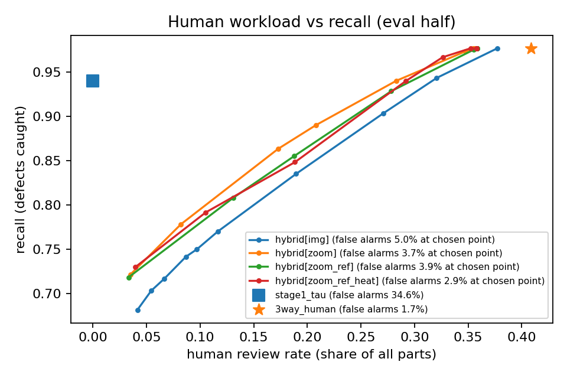
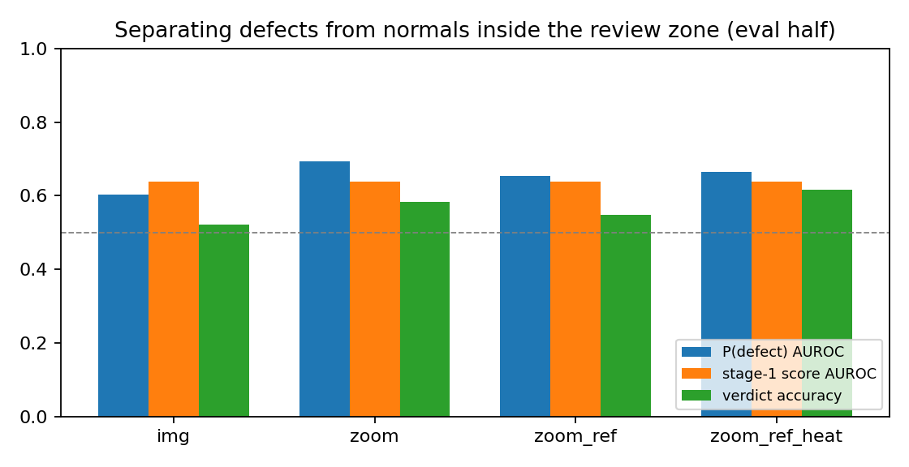

# VLM Inspection Cascade

**Where should a vision-language model sit on a visual inspection line?**

A two-stage inspection pipeline on the [VisA](https://github.com/amazon-science/spot-diff) industrial anomaly
dataset. A fast specialist detector (PatchCore) handles every part and makes a three-way decision:
auto-pass, auto-reject, or *send to re-inspection*. A tool-using VLM reviewer (Qwen2.5-VL-7B) then
re-judges only the uncertain parts, the job that human re-inspectors do after automated optical
inspection (AOI) on real lines.

**Result:** a zero-shot Qwen2.5-VL-7B reviewer takes over **14% of human re-inspection**
(40.9% -> 35.2% of all parts) at **unchanged recall (97.7%)** and +1.2 pp false alarms, but only as a
filter in front of humans, with its token probability thresholded on a calibration split. Without humans,
its yes/no answer lets 27-35% of all defects through, and its probability alone keeps recall only by
rejecting about 46% of normal parts.

Key findings (held-out half of the VisA test set):

1. **The VLM's verdict is biased towards "normal"; its confidence is unusable.** Inside the review band
   it calls only 12-34% of real defects defective, and its self-reported confidence takes 2-3 distinct
   values. The probability of the `"true"` token is a usable score instead.
2. **Detector-guided zoom is the tool that matters.** Separation of defects from normal parts inside the
   review band (AUROC of P(defect)) goes from 0.60 (full image) to **0.69** with two crops cut at the
   detector's heatmap peaks, above the detector's own 0.64 there. Reference images and the heatmap overlay
   add no further separation (0.65-0.67).
3. **Use it per product line.** The VLM beats the detector on appearance defects (candle 0.81 -> 0.92,
   capsules 0.62 -> 0.74) but is worse on dense PCB structure (pcb2 0.85 -> 0.70, pcb4 0.99 -> 0.86).
4. **Cost.** Stage 1 runs at 34 ms per image. The VLM reviews only the 41.6% review band: 0.6-0.9 s per
   image one at a time on an A100, 3-9 images/s batched.

## Why this setup

- **VLMs alone are not good enough to inspect.** On the MMAD benchmark the best model (GPT-4o) reaches
  74.9% accuracy, which its authors call far from industrial requirements
  ([MMAD, ICLR 2025](https://arxiv.org/abs/2410.09453)). Foundation models that look fine on public
  benchmarks can fail outright on real factory data
  ([KIT/Bosch reality check](https://arxiv.org/abs/2509.20479)). Agentic VLM detection also takes
  tens of seconds per image, far slower than a line's takt time.
- **Specialist detectors are fast but leave an uncertain band.** Factories route that band to people.
  That re-inspection workload is where a VLM could help, if it does not let defects slip through.
- So the question here is narrow and practical: **how much human re-inspection can a VLM reviewer take
  over, at what miss rate, cost and latency, and which tools make it better?**

## Method

| Stage | What it does |
|---|---|
| 1. Detector | PatchCore (WideResNet-50, layers 2+3, 10% coreset) via anomalib 2.7.0, one model per category, raw kNN scores |
| Three-way decision | `score < s_lo` auto-pass (recall >= 99% on calib), `score > s_hi` auto-reject (false alarms <= 1% on calib), otherwise review |
| 2. VLM reviewer | Qwen2.5-VL-7B-Instruct served with vLLM; returns JSON `{defect, confidence, type, location, reason}` |

Reviewer tools, added one at a time for an ablation:

| Variant | Images the VLM sees |
|---|---|
| `img` | the full part |
| `zoom` | + two crops at the detector's heatmap peaks, cut from the full-resolution image |
| `zoom_ref` | + two nearest defect-free reference parts (retrieved by thumbnail similarity) |
| `zoom_ref_heat` | + the detector's heatmap overlay |

Policies compared on the held-out half:

| Policy | Decision on the review band |
|---|---|
| `stage1_tau` | none: a single PatchCore threshold at recall >= 95% |
| `3way_human` | a human re-judges every review item (modelled as ground truth: the upper bound) |
| `3way_vlm` | the VLM's yes/no answer decides every review item, no human |
| `3way_vlmP` | the VLM's P(defect) decides every review item (`p >= t`), no human; `t` is the largest threshold with recall >= 98% on calib |
| `hybrid` | `p >= t_def` -> reject; `p <= t_ok` -> pass; otherwise a human. (`t_ok`, `t_def`) minimise human work on calib, subject to recall >= 98% and false alarms at most 2 pp above `3way_human` |

Here `p` is P(defect), the probability of the `"true"` token in the reviewer's JSON answer.

**No test-set tuning.** Each category's test set is split 50/50 (stratified, fixed seed) into
`calib` (every threshold above) and `eval` (every number reported below).

## Results

### Policies (eval half, 12 categories pooled, 1,081 images)

| Policy | Recall | False alarms | Human review | Notes |
|---|---|---|---|---|
| `stage1_tau` | 94.0% | 34.6% | 0% | one PatchCore threshold |
| `3way_human` | 97.7% | 1.7% | 40.9% | upper bound: humans re-judge the whole band |
| `3way_vlm[zoom_ref_heat]` | 73.3% | 6.6% | 0% | VLM yes/no decides the band: misses too much |
| `3way_vlmP[zoom_ref_heat]` | 97.7% | 46.1% | 0% | VLM probability decides the band: recall holds, but more false alarms than stage 1 alone |
| `hybrid[img]` | 97.7% | 5.0% | 37.7% | t_ok=0.0, t_def=0.8 |
| `hybrid[zoom]` | 97.3% | 3.7% | **34.8%** | t_ok=0.05, t_def=0.5 |
| `hybrid[zoom_ref]` | 97.5% | 3.9% | 35.5% | t_ok=0.05, t_def=0.4 |
| `hybrid[zoom_ref_heat]` | **97.7%** | **2.9%** | 35.2% | t_ok=0.1, t_def=0.6 |



### The reviewer inside the review band (eval half, 442 images)

| Variant | P(defect) AUROC | Verdict accuracy | Defect recall | Normal parts cleared | Prompt tokens | Latency, one at a time |
|---|---|---|---|---|---|---|
| `img` | 0.602 | 52.3% | 20.3% | 84.5% | 415 | 0.62 s |
| `zoom` | **0.694** | 58.4% | 21.6% | 95.5% | 997 | 0.86 s |
| `zoom_ref` | 0.653 | 54.8% | 11.7% | 98.2% | 1,524 | - |
| `zoom_ref_heat` | 0.665 | 61.5% | 34.2% | 89.1% | 1,797 | 0.81 s |
| *stage-1 score* | *0.639* | | | | | *34 ms* |



Per-category separation inside the band: [docs/per_category_review_auroc.csv](docs/per_category_review_auroc.csv).
Example decisions (caught, cleared, missed, false alarm): [docs/gallery_zoom_ref_heat.html](docs/gallery_zoom_ref_heat.html).
Full tables: [docs/results.md](docs/results.md).

### Stage 1 (PatchCore, image AUROC on the full test set)

| candle | capsules | cashew | chewinggum | fryum | macaroni1 | macaroni2 | pcb1 | pcb2 | pcb3 | pcb4 | pipe_fryum | mean |
|---|---|---|---|---|---|---|---|---|---|---|---|---|
| 0.970 | 0.700 | 0.974 | 0.996 | 0.938 | 0.882 | 0.595 | 0.954 | 0.939 | 0.952 | 0.992 | 0.989 | **0.907** |

In line with published PatchCore numbers on VisA at 256x256; capsules and macaroni2 (small defects on
busy texture) are the hard cases and send 80-90% of their parts to review.

## Limitations

- VisA is a public benchmark, not production data; real lines have other lighting, parts and defect
  rates, and foundation models are known to degrade there.
- Human re-inspection is modelled as perfect, so `3way_human` is an upper bound.
- About 50 defective images per category in each half, so per-category numbers are noisy; pooled numbers
  are more reliable.
- The VLM is used zero-shot with one fixed prompt written before any results were seen (no prompt tuning
  on test data), greedy decoding, one run. Fine-tuning the reviewer (e.g. RL with miss/false-alarm costs
  as reward) is the obvious next step and was left out to keep the project to a few days.

## Reproduce

Paths live in `scripts/env.sh`; put machine-specific ones in `scripts/env.local.sh`
(see `scripts/env.example.sh`). GPU numbers follow `nvidia-smi`.

```bash
bash scripts/server_setup.sh venv                 # venv with anomalib 2.7.0, torch 2.8
bash scripts/server_setup.sh visa                 # VisA, 1.93 GB
bash scripts/server_setup.sh wrn50                # WideResNet-50 ImageNet weights (torchvision)
bash scripts/server_setup.sh qwen                 # Qwen2.5-VL-7B-Instruct, 16.6 GB (vLLM installed separately)

GPU=0 bash scripts/run_stage1.sh --prepare-only   # extract + split once
GPU=0 bash scripts/run_stage1.sh                  # PatchCore on all 12 categories (~1.5-7 min each)
bash scripts/run_py.sh src/build_band.py          # thresholds on calib, three-way zones
CUDA_VISIBLE_DEVICES=1 bash scripts/serve_vlm.sh  # vLLM on port 8901, in another tmux window
bash scripts/run_py.sh src/vlm_review.py          # 4 reviewer variants x 900 images (~15 min on one GPU)
bash scripts/run_py.sh src/evaluate.py            # tables + figures in outputs/cascade/
bash scripts/run_py.sh src/gallery.py --variant zoom_ref_heat
```

## Data and model licences

VisA (Amazon): CC BY 4.0 per the [AWS Open Data registry](https://registry.opendata.aws/visa)
(some sources list CC BY-NC-SA 4.0). The example images in `docs/gallery_zoom_ref_heat.html` come from
VisA and are shown for non-commercial research. Qwen2.5-VL-7B-Instruct: Apache 2.0. No datasets or model
weights are stored in this repository.
